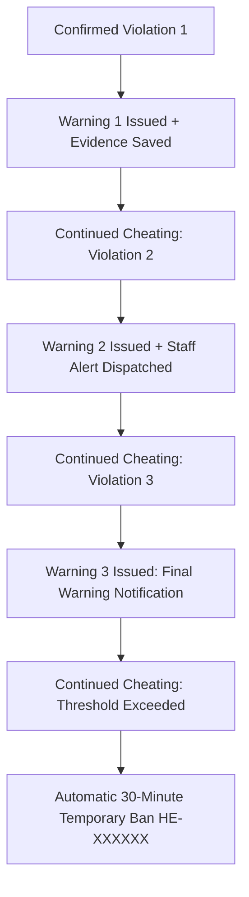

# AUTOMATED PUNISHMENT SYSTEM — HEAVEN EYES

**Author:** LivingYuji  
**Target Platform:** Paper 1.21.x  

---

## 1. Overview & Core Philosophy

Heaven Eyes utilizes an **evidence-based graduated punishment model**. Rather than banning players on raw packet anomalies or single-tick latency spikes, the system incorporates:
1. **Confidence Scoring:** Each violation requires calculated statistical confidence meeting or exceeding the check's `minimum-confidence` threshold.
2. **Rate Limiting:** A `repeated-detection-window` (default 60s) prevents multiple warnings from issuing within milliseconds during a single stutter or lag event.
3. **Evidence Persistence:** Incident evidence files are serialized to disk *before* automated punishments are executed.
4. **Distinction Between Conclusive & Heuristic Checks:** Conclusive checks (Speed, Reach, KillAura) support automated warnings and temporary bans; heuristic checks (Mining Analytics, Container ESP, Freecam) operate in `REVIEW` mode by default.

---

## 2. Default Warning Progression Model

For checks configured with `WARN_THEN_TEMPBAN` (Movement and Combat):

1. **Warning 1:** Issues warning #1 to the player. Saves incident evidence under `evidence/incidents/<id>.yml`.
2. **Warning 2:** Issues warning #2 to the player. Dispatches staff alert highlighting repeated suspicious activity.
3. **Warning 3:** Issues warning #3 as a final warning.
4. **Enforcement (30m Tempban):** If cheating continues after the third warning and the punishment threshold is reached, Heaven Eyes automatically issues a **30-minute temporary ban** (`30m`), kicks the player, and logs the action to `audit/audit.log`.

---

## 3. Severe Violation Handling

For extreme, high-confidence violations (confidence >= 0.98 or severe anomaly):
- **Immediate Severe Kick:** If `severe-kick-enabled` is true, the player is immediately disconnected with a severe incident notice.
- **Repeat Severe Action:** If severe infractions persist, the automated temporary ban is invoked directly.

---

## 4. Review-Only Checks (Anti-Xray, ESP, Freecam)

Client-side visual modifications (X-ray texture packs, ESP outlines, Freecam camera detachment) cannot be observed directly through client packets alone. Therefore, Heaven Eyes enforces a strict policy:
- **`REVIEW` Mode:** Suspicious mining ratios (e.g. > 18% diamond ratio) or occluded container interactions record incidents and alert staff, but **never trigger automated kicks or bans**.
- This protects legitimate lucky miners and complex redstone builds from false-positive bans while arming staff with empirical evidence.

---

## 5. False-Positive Protections

Heaven Eyes incorporates multi-layered false-positive safeguards:
- **Ping Compensation:** Reach calculations factor in player network latency (`attacker.getPing()`).
- **Teleport Grace Periods:** 1.5-second immunity window following teleports, respawns, and dimension changes prevents false speed flags.
- **Velocity Tracking:** Players receiving knockback or explosions are granted grace windows to allow legitimate physics resolution.
- **Gamemode Immunity:** Creative and spectator modes are automatically exempted.
- **Concurrency Locks:** Prevents duplicate punishment execution for simultaneous events in the same server tick.
